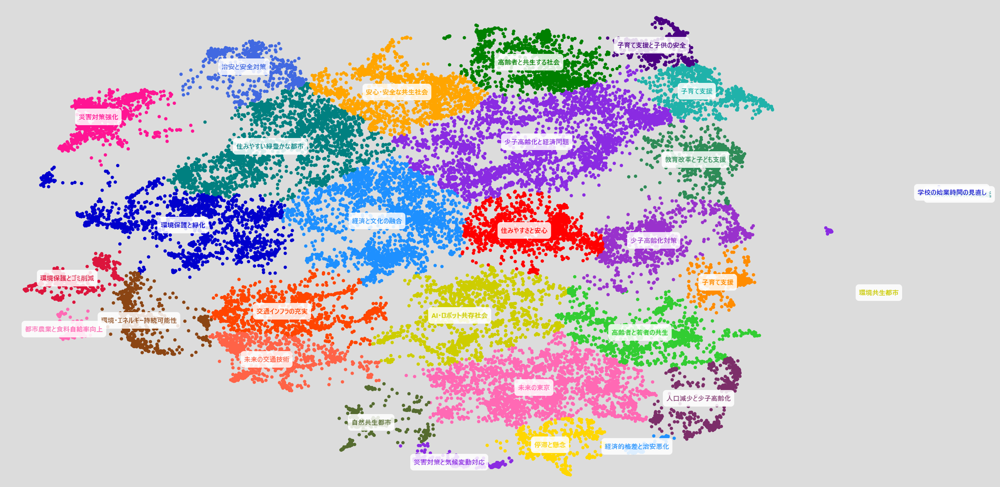
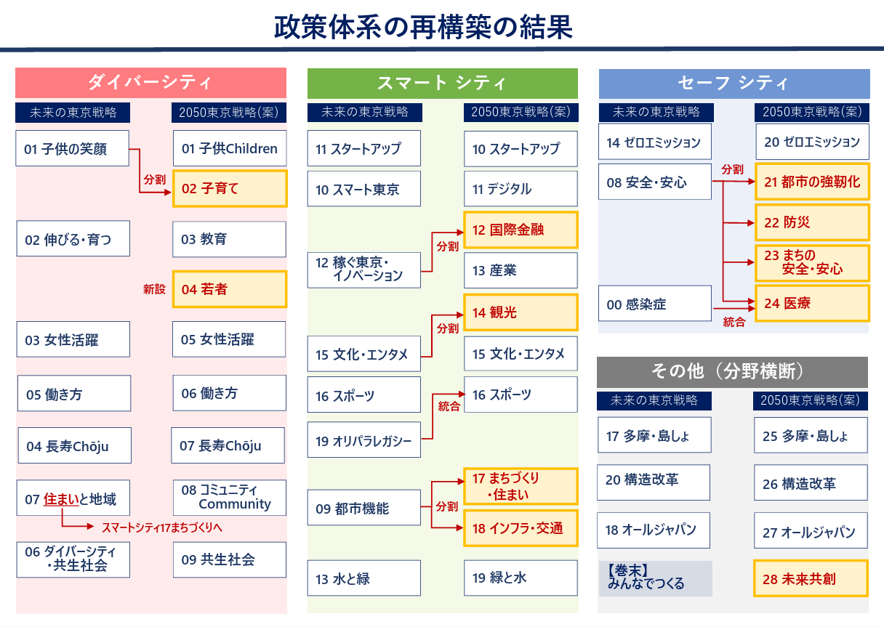
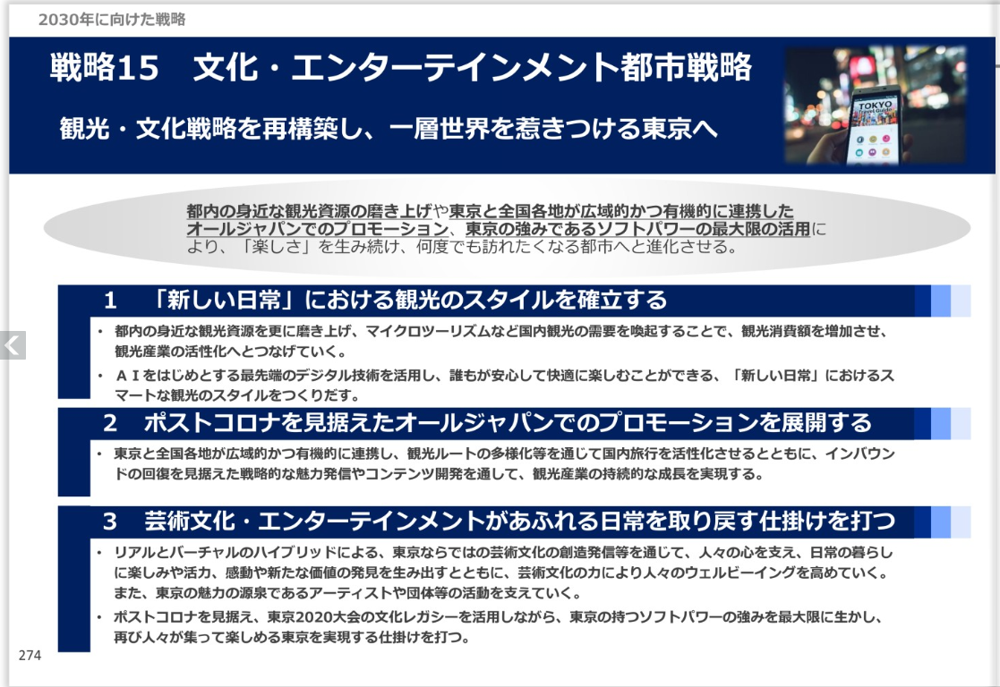
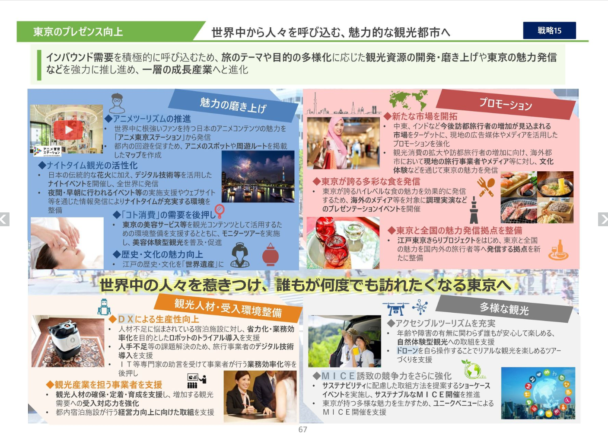
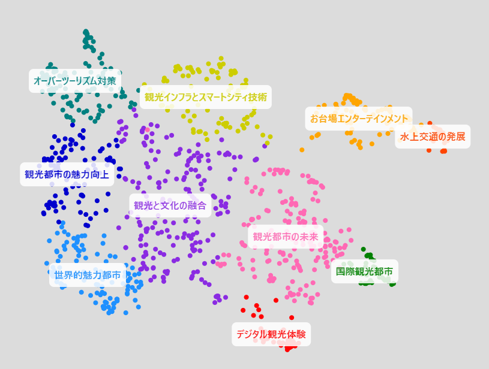
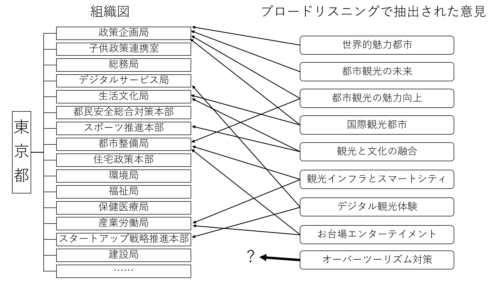

# 第5章 シン東京2050、ブロードリスニングは1400万都市を変えたか

文責：tokoroten

## 5.1 1400万人都市の挑戦：シン東京2050プロジェクト

2024年11月22日、東京都は「[みんなでつくる『シン東京2050』プロジェクト](https://www.seisakukikaku.metro.tokyo.lg.jp/basic-plan/choki-plan/ikenbosyu)」を開始しました。2050年代を見据えた新たな長期戦略「2050東京戦略」の策定にあたり、都民の声を広く集めようという試みです。この戦略のキャッチコピーは「東京 もっとよくなる」。すべての人が輝き、一人ひとりが幸せを実感できる「世界で一番の都市・東京」の実現を目指すというビジョンのもとに策定されました。

従来、行政が市民の意見を聴く手段といえばパブリックコメントが一般的でした。しかしパブリックコメントには限界があります。形式ばった意見募集に応じるのは一部の関心層に限られ、集まる意見は数百件程度にとどまることがよくあります。1400万人を超える人口を抱える東京都において、この規模で都民の声を幅広く把握することには無理があります。

シン東京2050プロジェクトでは、ブロードリスニングの手法を用いてこの課題に挑みました。約1か月の募集期間（11月22日〜12月20日）で集まった意見は27,915件。従来のパブコメの数十倍から数百倍という規模です。

意見収集には6つのチャネルが用意されました。

1. **専用Googleフォーム**: 最もオーソドックスな方法
2. **X（旧Twitter）**: ハッシュタグ「#シン東京2050」および「#百合子に言っといて」での投稿を収集
3. **YouTube**: 小池都知事の記者会見動画へのコメント
4. **メール**: 従来型のメールでの意見送付
5. **郵送**: デジタルに不慣れな層への配慮
6. **街頭インタビュー**: 街頭で都民の意見を聞き取り

Xのハッシュタグ投稿やYouTubeコメントといったSNS上の意見も分析対象とすることで、行政の意見募集に自ら応じることのない層の声も拾い上げようとしました。

実際、インターネット経由での募集では、従来のパブリックコメントでは聞こえてこなかった若年層の声が多く集まったといいます。行政の意見募集に応じるのは中高年層が中心という従来の傾向が、オンラインチャネルの活用によって変化しました。

一方で、デジタルチャネルだけでは届かない声もあります。東京都の職員は休日に上野動物園を訪れ、子供たちから直接意見を聞くという取り組みも行いました。技術協力を行った安野貴博氏は「データソースを散らすのがひとつ大事なことだと思う」と述べており、オンラインとオフラインを組み合わせた意見収集が試みられました[^ntv_bl]。

[^ntv_bl]: 日テレNEWS「[AI技術で「民意を見える化」東京都 長期戦略づくりの舞台裏](https://www.youtube.com/watch?v=b8-zEjbZZfk)」（2025年）

技術面では、東京都が全額出資して設立した一般財団法人[GovTech東京](https://www.govtechtokyo.or.jp/)が分析を主導しました。GovTech東京は都と区市町村のデジタル化推進を担う専門組織で、宮坂学副知事（当時）が理事長を務めています。シン東京2050プロジェクトの開始と同じ2024年11月22日、安野貴博氏がGovTech東京のアドバイザーに就任し、ブロードリスニングシステムの構築を支援しました。GovTech東京はオープンソースの意見分析ツール「[Talk to the City](https://github.com/AIObjectives/talk-to-the-city-reports)」を用いて約2万8千件の意見をAIでクラスタリング・可視化するシステムを構築しました。

収集された意見は2025年1月31日に[分析結果が公開](https://broadlistening.seisakukikaku.metro.tokyo.lg.jp/20250131/index.html)され、同年3月に策定された「[2050東京戦略](https://www.seisakukikaku.metro.tokyo.lg.jp/basic-plan/2050-tokyo/)」に反映されたとされています。

*図：27,915件の意見を全件クラスタリングした分析結果。各色のクラスターが異なるテーマ群を表しており、子育て・教育・若者支援に関するクラスターが多数形成されているのが確認できる。（出典：東京都政策企画局 [ブロードリスニング分析結果](https://broadlistening.seisakukikaku.metro.tokyo.lg.jp/20250131/index.html)）*

## 5.2 東京都の公式発表：20+1戦略から28戦略へ

東京都の公式発表によれば、ブロードリスニングの成果は政策体系の大幅な再編として結実しました。[公式サイト](https://www.seisakukikaku.metro.tokyo.lg.jp/basic-plan/2050-tokyo/)には次のように記されています。

> AI分析により、都民の関心事項・課題を浮き彫りにし、戦略の政策体系を見直しました。

従来の「[未来の東京](https://www.seisakukikaku.metro.tokyo.lg.jp/basic-plan/choki-plan/)」戦略（2021年策定）では「20+1」の戦略体系だったものが、「2050東京戦略」では28の戦略に拡充されました。戦略は「ダイバーシティ」「スマートシティ」「セーフシティ」の3つの柱と「その他（横断分野）」に整理されています。

**ダイバーシティ**: 子供、子育て、教育、若者、女性活躍、働き方、長寿、コミュニティ、共生社会

**スマートシティ**: スタートアップ、デジタル、国際金融、産業、観光、文化・エンタメ、スポーツ、まちづくり・住まい、インフラ・交通、緑と水

**セーフシティ**: ゼロエミッション、都市の強靭化、防災、まちの安全・安心、医療

**その他（横断分野）**: 多摩・島しょ、構造改革、オールジャパン、未来共創

東京都はこの再編においてブロードリスニングが重要な役割を果たしたと説明しています。

しかし、この取り組みを紹介する外部の論者の多くは、28戦略の中から「観光」の独立を取り上げ、「東京という超大都市が『観光』というテーマを発見した。すなわちブロードリスニングによる見落としの発見が政策を変えたのだ」というナラティブで語りがちです。このナラティブは本当でしょうか。次節で検証します。

## 5.3 成果の検証：何が変わり、何が変わらなかったのか

### 比較対象の問題

ここで立ち止まって、東京都の発表を検証してみます。東京都の公式発表では、2021年策定の「未来の東京」戦略と2025年の「2050東京戦略」を比較しています。確かにこの比較では、戦略体系は大きく変化しているように見えます。

しかし、ブロードリスニングの効果を正しく評価するためには、適切な比較対象を選ぶ必要があります。

*図：2021年策定の「未来の東京」戦略。観光は「文化・エンターテインメント都市戦略」の中の一施策として位置づけられており、独立した戦略体系ではない。コロナ禍・インバウンド停止という時代背景が色濃く反映されている。*

「未来の東京」戦略は2021年3月に策定されました。この時期を思い出してください。新型コロナウイルスの感染拡大の真っ只中であり、東京オリンピック・パラリンピックの開催すら危ぶまれていた時期です。インバウンド観光は事実上停止し、訪日外国人の統計調査すら中止されていました。

この文脈を踏まえれば、2021年版に「観光」が独立戦略として存在しなかったのは当然です。コロナ禍で観光産業が壊滅的な打撃を受けている最中に、観光振興を戦略の柱に据えることは現実的ではありませんでした。ただし、2021年版でも観光施策が皆無だったわけではありません。多摩地域や離島など、東京における過疎地域のツーリズム推進は盛り込まれていました。インバウンドが期待できない状況下で、都内の地域振興と結びつけた観光政策が採られていました。

実際、東京都は毎年「version up」として戦略を更新しており、2024年1月には「未来の東京」戦略 version up 2024が公開されています。この時点で観光施策の重点は大きく変化し、ナイトタイム観光、アニメツーリズム、アクセシブルツーリズムなど、都心部を中心とした都市観光に軸足が移っていました。インバウンド回復を見据えた施策への転換です。

*図：2024年1月公開のversion up。ナイトタイム観光・アニメツーリズム・アクセシブルツーリズムなどインバウンド回復を見据えた施策が大幅に拡充されている。この更新はブロードリスニング実施（2024年11月〜）より前のものだ。*

※出典：[「未来の東京」戦略](https://www.seisakukikaku.metro.tokyo.lg.jp/basic-plan/choki-plan/)（東京都政策企画局）

つまり、ブロードリスニングの実施（2024年11月〜12月）より前に、観光施策の拡充は進んでいました。

| 比較 | 印象 | 実態 |
|------|------|------|
| 2021年版 → 2050東京戦略 | 劇的な変化 | コロナ収束・五輪終了・インバウンド回復の4年分を含む |
| version up 2024 → 2050東京戦略 | 漸進的な更新 | ブロードリスニング後の実際の差分 |

また、戦略体系の変化の実態は「新発見」ではなく「分割」です。観光は「文化・エンタメ」から細分化されました。「行政が見落としていた分野をAIが発見した」のではなく、「従来一括りにされていた分野を意見の分布に基づいて細分化した」というのが正確な表現です。

### 消えた戦略の意味

一方で、2021年版から消えた戦略もあります。

- **戦略0：感染症に打ち克つ** → コロナ収束により削除
- **戦略19：オリンピック・パラリンピックレガシー** → 五輪から4年経過、スポーツ等に統合

これらの変化はブロードリスニングの結果というより、時代の変化による自然な更新です。コロナが収束すれば感染症対策の優先度は下がり、五輪が終われば「レガシー」は各分野に統合されていきます。どの自治体でも同様の更新が行われるはずです。

以上の検証を踏まえると、東京都の「ブロードリスニングが政策を変えた」という物語は、少なくとも部分的には過大評価です。一方で、ブロードリスニングならではの貢献もありました。次節では、過大でも過小でもない評価を試みます。

## 5.4 ブロードリスニングは何をもたらしたか

### 聞こえなかった声を拾い上げる

ブロードリスニングがもたらした価値の一つは、従来の仕組みでは聞こえなかった声を拾い上げたことにあります。誰の意見が政策に届くかは、収集の仕組みそのものによって決まります。シン東京2050はその仕組みを意識的に設計し直そうとした試みとして位置づけられます。

背景にあるのは「シルバーデモクラシー」の問題です。選挙における世代別の政治的影響力は、おおむね「世代別人口×世代別投票率」で決まります。日本では少子高齢化により高齢者の世代人口自体が多く、さらに高齢者は若年層より投票率が高くなっています。この二重の効果により、政策は高齢者の意向に引っ張られやすく、高齢者福祉を優先する政策が生まれやすくなります。

「すべての人が輝く東京」というビジョンが意味を持つためには、そのすべての人の声が政策に届く仕組みが必要です。しかしシルバーデモクラシーの構造が残る限り、若者の声は届きにくいままです。投票を呼び掛けるだけでは足りません。さらに言えば、18歳未満には選挙権がありません。2050年の未来に最も長く生きる子どもたちが、その社会のかたちを決める意思決定から制度的に排除されているのは、民主主義の根本的な矛盾といえます。

東京都がSNSハッシュタグの収集と上野動物園での子どもへのインタビューを組み合わせたのは、シルバーデモクラシーに対処し、選挙制度では掬えなかった声を政策に届けるための工夫だったと解釈できます。若者が多いチャネルで声を集めることには、未来に対する政策の正統性を高める意図があったとも読めます。

実際に公開された分析結果を見ると、教育カテゴリには「教育改革」「教育の未来」「多言語教育の強化」「学校の始業時間の遅延」「少子化対策と子育て支援」など、子どもや若者の未来を問う複数のクラスターが形成されました。若者カテゴリでも「少子化対策と若者支援」「若者支援と活躍」「若者支援と高齢者共生」など、「若者支援」を軸とするクラスターが複数並んでいます。また、最終的な政策体系「2050東京戦略」でダイバーシティ分野に「子供」「子育て」「教育」「若者」が独立した戦略として位置づけられたのも、こうした意見の集積を反映しています。

シルバーデモクラシーのもとでは表出しにくかった「子育てしやすい環境を」「教育費を無償化してほしい」「若者が夢を持てる東京に」という声が、SNSやオンラインチャネルを通じて大量に届いた結果です。行政の意見募集に自発的に応じることが少なかった子育て当事者や若者世代が、Xへの投稿や専用フォームを通じて積極的に声を発信しました。その結果、こうした声が「件数」としても「クラスター数」としても可視化されました。

### 論点地図として機能する

もう一つの価値は、政策判断に根拠を与えることにあります。ブロードリスニングは、意見をクラスタリングして「論点地図」を描くことで、その根拠を提供します。感覚だけでは「なぜ観光を独立した戦略として位置づけるのか」を市民に説明できません。件数論拠も収集チャネルのバイアスに直接左右されるため脆弱です。どのサブテーマが存在し、どう配置されているか。それが政策判断の根拠として機能します。

実際に[観光カテゴリのTTTC可視化結果](https://broadlistening.seisakukikaku.metro.tokyo.lg.jp/20250131/tourism/index.html)を見てみましょう。

10のクラスタには「国際観光都市」「世界的魅力都市」「デジタル観光体験」「観光都市の魅力向上」「観光と文化の融合」「お台場エンターテインメント」「水上交通の発展」といった都市観光の推進に関するものが並びます。加えて、「オーバーツーリズム対策」が独立したクラスタとして出現しました。観光振興への期待と弊害への懸念が、観光というひとつのテーマの中に共存しています。

件数だけを数えれば「観光関連の意見が多い」ということしか分かりません。しかしクラスタの分布を描けば、振興系と抑制系が同じテーマの中に並立しているという形まで見えます。この並立の形が政策体系の再編にどう接続したかは、次項で論じます。

こうして描かれた意見の地図を政策過程に接続する作業が、ブロードリスニングの実際の貢献です。シン東京2050プロジェクトでは「2050東京戦略」の[各戦略ページ](https://www.seisakukikaku.metro.tokyo.lg.jp/basic-plan/2050-tokyo/shinchoku)に「AIによる都民意見の要約」が掲載されており、どの都民の声がどの戦略に対応しているかが可視化されています。従来のパブリックコメントが「いただいた意見は今後の参考にさせていただきます」という定型文で終わっていたのとは対照的です。

### 独立に至った流れを推測する

では、東京都はなぜ「観光」を独立した戦略として位置づけるに至ったのでしょうか。東京都はワークフローの詳細を公開していないため以下は筆者の推測ですが、ここで起きていたのは観光というテーマの性格変化と、それを受け止める組織構造との摩擦だったと考えます。

行政の戦略体系は、担当部局の管轄範囲と強く結びついています。どの分野をどの局・課が担当するかという組織構造が、戦略のカテゴリ体系に反映されます。ソフトウェア工学の世界では「組織が作るシステムは、その組織のコミュニケーション構造を映す」という法則（コンウェイの法則）が知られていますが、行政の戦略体系にも同じ力学が働きます。「未来の東京」戦略のカテゴリ体系は、東京都の局・課の管轄範囲とほぼ対応していたと考えられます。

ブロードリスニングが行ったことは、この組織体系とは無関係に市民の声をクラスタリングし、論点地図を描くことです。そのクラスタ群を既存の戦略体系に照らし合わせると、収まりきらないものが出てきます。前述の観光カテゴリを例にとり、東京都の既存の部局との対応を行ってみると次の図のようになります。

ほとんどのクラスタは、既存部局のいずれかに引き取れます。「国際観光都市」「都市観光の魅力向上」「デジタル観光体験」「お台場エンターテイメント」などは、産業労働局・生活文化局・都市整備局などに振り分けられます。観光振興という意味でいえば、既存の縦割りに収まります。

しかし「オーバーツーリズム対策」だけが宙に浮きます。混雑や住民生活への影響への対処は振興系の局と噛み合わず、かといって環境局などに丸ごと渡せるわけでもありません。動線の制限や受け入れ容量の管理といったトレードオフは、観光振興の意思決定と切り離して扱えないからです。

ここで起きているのは、観光というテーマの性格そのものの変化です。これまで「文化・エンタメ」の一サブテーマとして振興対象（アクセルを踏む対象）だった観光が、市民の声を構造化することで「推進と抑制を同時にコントロールすべき対象」として浮かび上がります。集客と混雑緩和、賑わい創出と住民生活の保護は、観光現場で同時に判断すべき一体のトレードオフです。機能別に縦割りされた行政組織には、こうした「アクセルとブレーキを同時に踏む」役割を引き受ける箱が用意されていません。

このテーマ変質を戦略体系に反映させたのが、観光の独立化です。独立戦略にすれば推進と抑制を同じ枠で併置でき、それに対応した組織を整備する根拠も生まれます。

これは観光に限りません。産業振興と環境保全、デジタル推進とプライバシー保護のように、「推進すべきもの」だったテーマが「推進と抑制を同時に制御すべきもの」へ性格を変える場面は、行政の各所に存在します。市民の声を組織と無関係にクラスタリングすると、こうした変化が起きているテーマが浮かび上がってきます。

AIが「観光を独立させるべき」と提案したわけではありません。AIの分類結果と既存体制の摩擦を人間が解釈し、「このカテゴリは分割すべきではないか」という問いを立てます。ブロードリスニングが提供したのは、この問いを立てるための材料です。

なお、この問いは「劇的な発見」ではありません。5.3節で見たように、観光施策の拡充は2024年のversion upで既に進んでいました。しかしそれで構いません。既知の課題でも、市民の声として構造化されることで、政策体系の見直しを後押しする根拠になります。「観光を独立させよう」という判断に、「市民の声の構造がそう示している」という根拠が加わります。クラスタ分析の結果は、そのような正統性の裏付けとなりました。

ただし、示せるのは「寄せられた意見の中での構造」であって「社会全体の意見分布（統計的世論）」ではありません。構造的根拠は感覚や件数よりも説明力がありますが、統計的世論の証明であるかのように語られるとき、根拠は誇張になります。

## 5.5 この事例が示すもの

シン東京2050プロジェクトは、日本の行政におけるブロードリスニング導入の初期事例として、今後の参照点になります。その意義と限界を整理しておきます。

### 「ブロードリスニングで変えた」という物語の危うさ

一方で懸念もあります。東京都の公式発表は「AI分析により戦略の政策体系を見直した」と強調しています。しかし5.3節で見たように、変化の大部分は時代の変化（コロナ収束、インバウンド回復）と既存の政策更新の蓄積によるものです。

ブロードリスニングの貢献を過大に語る「物語」は、二つの意味で危険です。一つは、技術への過剰な期待を生み出すこと。もう一つは、行政が既に進めていた方針転換を後付けで正当化するものとして使われるリスクです。「市民の声を聞いてこう変えた」という説明が、実は変えるつもりだったことの追認にすぎないとすれば、透明性が高まるどころか、その説明はかえって不誠実なものになってしまいます。

今後この技術を行政が活用する際、「ブロードリスニングの結果が政策を変えた」という因果関係を主張するなら、それを検証可能な形で示す必要があります。

### 問いを立てる道具として

シン東京2050は、前節で述べた「問いを立てる材料の提供」という役割を、1400万人規模の都市政策で実証しようとした試みとして位置づけられます。

以下は筆者の推測ですが、この規模だからこそ見えたものがあったはずです。意見クラスタと組織構造のズレは、市民が感じている課題と行政の縦割り構造がかみ合っていないという問題を可視化したでしょう。シルバーデモクラシーについても、うすうすは分かっていたはずですが、表立って語りにくいこの構造的問題に対し、SNSや街頭インタビューというアプローチで是正を模索したと読めます。

いずれも「知らなかった事実の発見」ではなく、「薄々わかっていたこと」に対するアプローチです。「ブロードリスニングが政策を変えた」という物語は過大ですが、「問いを構造化し、変化の正統性を支えた」という評価は成立します。そしてこの手法は東京都にとどまりませんでした。2025年7月の参議院選挙では、複数の政党がブロードリスニングを取り入れることになります。その展開は次章で扱います。

