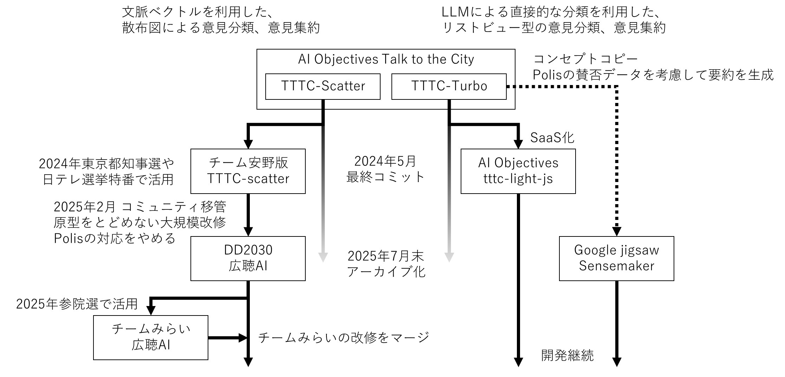

# DD2030による広聴AIの開発活動

<!-- tokorotenとnishioとsuminoが書く -->

## デジタル民主主義2030 について

デジタル民主主義2030（DD2030）は、2025年1月にAIエンジニアの安野たかひろと、スマートニュース取締役会長・東京大学特任研究員の鈴木健が共同で立ち上げた非営利のオープンソースプロジェクトです。鈴木健は『なめらかな社会とその敵』の著者として知られ、複雑系科学や自然哲学の観点からデジタル民主主義の可能性を長年探求してきた人物で、DD2030の思想的な基盤に深く関わっています。

2024年の東京都知事選において、安野の選挙活動を支えたボランティアチーム「チーム安野」がブロードリスニングの取り組みを進めました。その後、日本テレビの衆院選特番での意見分析や、東京都の長期戦略策定における活用など、実践の場は徐々に広がっていきました。こうした活動を単発のプロジェクトにとどめず、自治体・政党・政治家など多様な主体が中立的に利用できる形で継続的に社会へ届けていくために、チーム安野を母体としてデジタル民主主義2030が組織されました。

DD2030が一貫して重視するのが政治的中立性です。特定の政治家や政党に肩入れするのではなく、民主主義の土台となるインフラを整備するという立場を取ることで、与野党を問わず複数の政党や自治体を支援しています。「2030年までに、情報技術によって民主主義のあり方がアップデートされ、一人ひとりの声が政治・行政に届く社会を当たり前にする」という目標のもと、設立時に広聴AI、熟議プラットフォーム「いどばた」、政治資金の透明化ツール「Polimoney」の3つの開発プロジェクトを公表し、デジタル民主主義を支える活動を推進しています。

その後、2025年5月に安野がチームみらいを結党して2025年参院選に立候補することに伴い、政治的中立性を保つため結党に先立ちDD2030のボードメンバーを退任しました。しかしコミュニティとしての開発活動は継続しており、安野の離脱後も広聴AIをはじめとする各プロジェクトの改善と普及活動は続いています。

なお本書はデジタル民主主義2030の活動の一環として有志により執筆されています。

## 広聴AIとは

広聴AIは、多様な市民の声を広く収集・可視化し、意思決定に役立てるためのオープンソースのAI分析ツールです。Talk to the City（TTTC）をベースに、デジタル民主主義2030プロジェクトで開発されました。

CSVファイルをアップロードするだけで、大量の意見データをAIがクラスタリング・要約し、全体像を把握できる形で可視化します。これにより、膨大な手作業を要することなく効率的に意見を分析し、有益なインサイトを提供できます。パブリックコメントの分析、政党の政策立案、地域の計画策定など、幅広い場面での活用が想定されています。

### Talk to the Cityから広聴AIへ

広聴AIの起源は、米国AI Objective Instituteによって開発された、大量の意見を収集・可視化するオープンソースツール「Talk to the City（TTTC）」にさかのぼります。TTTCには、文脈ベクトルと散布図で意見を分類・可視化する「TTTC Scatter」と、LLMによる直接的な分類でリストビュー型の表示を行う「TTTC Turbo」の2つのバリエーションがあります。いずれも台湾など世界中で実際に活用された実績があります。

都知事選や日テレ選挙特番を通じて、チーム安野はTTTC Scatterを活用してブロードリスニングの実践を重ねていたが、その過程でTTTC Scatterにはいくつかの課題があることが明らかになりました。

一つは、活用するためのハードルが高いという課題です。TTTC Scatterはコマンドライン[^cli]で動作するツールであるため、Python環境の構築等のソフトウェアエンジニアリングのスキルが必要でした。
TTTC Scatterは内部でLLM（大規模言語モデル）を活用して分析を行っているため、分析する際にLLMに与える指示（プロンプト）を書く必要があります。プロンプトを書くことはソフトウェア開発の知識がなくとも本来できるはずですが、前述の通り、コマンドラインツールであったため、分析者にソフトウェアエンジニアリングのスキルが求められるという構図になっていました。

また、クラスタリングのアルゴリズムにも課題がありました。TTTC Scatterでは、単一の決められたクラスタ数でクラスタリングを実行します。クラスタの粒度が粗すぎれば意見の違いが埋もれ、細かすぎれば全体像が見えなくなるため、適切な粒度を探して何度も分析をやり直すことも多くありました。

これらの課題とニーズに応えるため、より多くのユーザーがブロードリスニングを実施し、より示唆を得られるようにするためにTTTC Scatterのフォーク（fork）として、広聴AIの開発が開始されました。

余談ですが、フォークとは「フォークとスプーン」のフォークです。フォークには「分岐したもの」という意味があり、ソフトウェア開発の世界では、既存のプロジェクトからコードを引き継いで新しいプロジェクトを作ることをフォークと呼びます。単なるコピーと違い、フォークは親プロジェクト（本家）とのつながりを保ちながら独自の進化を遂げられる「分身」のような存在です。本家の改善を取り込みつつ、自分たちの目的に合った独自の機能追加を進めることができます。

広聴AIは、当初はチーム安野の開発者が中心となって開発が進められていたが、2025年3月16日にオープンソースソフトウェア（OSS）として公開され、DD2030コミュニティから多くの開発者が参加するようになりました。

### 広聴AIの設計：Webアプリケーションとしての実装

広聴AIの最大の特徴は、TTTC Scatterをコマンドラインツールからブラウザで操作できるWebアプリケーションへと作り変えたことです。アプリケーションのホスティングにはエンジニアリングスキルが必要だが、一度立てた後は開発の知識がなくとも分析を実行でき、URLを共有するだけで誰でも結果にアクセスできます。

広聴AIとTTTC Scatterの主な違いは以下の通りです。

| 観点 | TTTC Scatter | 広聴AI |
|------|------|--------|
| 提供形態 | CLIツール | Webアプリ |
| 環境構築 | ユーザー側で必要 | サーバー側で完了 |
| 分析の実行 | コマンドライン | ブラウザから操作 |
| 結果の共有 | HTMLをホスティング | URLを共有するだけ |

広聴AIでは、分析アルゴリズムにもいくつかの改良を加えました。

**階層クラスタリング**

TTTC Scatterでは単一の階層でクラスタリングを実行していたが、広聴AIでは階層的にクラスタリングを実行します。これにより、様々な粒度で意見の構造を把握できるようになりました。従来の散布図による可視化に加えて、階層構造を可視化するためのツリーマップも追加しました。

**濃いクラスタの抽出**

密度の高いクラスタのみを抽出する機能も実装しました。密度の低いクラスタには、関連性の薄いデータが混在している可能性があります。これを除外することで、より明確な分析結果を得られるようになりました。

**クラスタリングアルゴリズムの変更**

TTTC Scatterと広聴AIでは、クラスタリングに使用するアルゴリズムが異なります。

TTTC Scatterではスペクトラルクラスタリングを採用しています。スペクトラルクラスタリングはデータ点間の近傍グラフを構築し、そのグラフ構造に基づいてクラスタリングを行う手法です。このアルゴリズムでは、グラフ上でつながっている点が同じクラスタに分類されるため、2次元平面上では離れた位置にある点が同じクラスタに含まれることがあります。結果として、散布図上でクラスタが飛び地のように分散して表示されることがあり、ユーザーにとって解釈が難しくなる場合がありました。

一方、広聴AIではK-meansを採用しています。K-meansはデータ点間のユークリッド距離に基づいてクラスタリングを行う手法で、空間的に近い点が同じクラスタにまとめられます。これにより、散布図上でクラスタがまとまって表示されるようになり、視覚的な解釈がしやすくなりました。

ただし、K-meansにはデメリットもあります。K-meansは「丸い形のかたまり」を見つけるのが得意な反面、ねじれていたり広がりがあったりする複雑な形のかたまりは苦手です。Spectral Clusteringなら検出できたはずの意味的に関連するグループが、K-meansだと細かく分断されてしまう可能性があります。それでも広聴AIがK-meansを採用したのは、精密さよりも「見た目のまとまり（直感的なわかりやすさ）」を優先したからです。一般市民や政治家が散布図を見る前提では、近くに表示された点が同じクラスタである方が混乱が少ない、という判断でした。

### 広聴AIの意義

広聴AIにより、ブロードリスニングはプログラミングスキルや特別な知見がなくとも実施できるようになりました。CSVをアップロードするだけで分析を実行でき、URLを共有するだけで結果を公開できます。環境構築にはまだエンジニアリングスキルが必要であるものの、分析の実行と共有のハードルは大きく下がりました。

また、オープンソースであることは、分析プロセスの透明性が求められる行政利用に適しています。どのようなアルゴリズムで意見が分類・要約されているかをコードレベルで検証できるため、分析結果の説明責任を果たしやすくなります。詳細な実装については、12章、13章で解説しますが、オープンソースプロダクトなので、AIを片手にソースコードを読み解いてみてください。

## 2025年5月の転機

2025年5月は、広聴AIの開発にとって「減速と加速が同時に起こった」転換点となりました。

### コミュニティの分散

2025年5月7日、DD2030を立ち上げた安野はDD2030のボードメンバーを退任しました。翌5月8日にはチームみらいを正式に結党し、2025年参院選に向けた政治活動を本格化させたためです。DD2030の政治的中立性を保つために自ら退任を決断したものですが、運営体制に大きな影響を与えました。

DD2030はチーム安野を母体として組織されていたため、安野がチームみらいを立ち上げると、もともとチーム安野で活動していたエンジニアやデザイナーの多くが、自然とチームみらいのコミュニティへと活動の場を移しました。さらに、広聴AIの主要開発者が、チームみらいから立候補を決断したことで、開発リソースは急激に減少しました。

チームみらいに移る者、DD2030に残る者、両方のコミュニティを行き来する者など、個人ごとに様々な動きがありました。広聴AIはオープンソースプロジェクトとして公開されていたため、開発者の入れ替わりはむしろコミュニティの特性とも言えます。誰でもコードに貢献できるため、開発が完全に止まることはありませんでした。

### チームみらい版の誕生

チームみらいは2025年参院選に向けた独自の要件に対応するため、広聴AIのリポジトリをフォークして独自開発を進めました。フォークすることで、DD2030側の承認を待たずにチームみらい側のエンジニアの判断だけで機能を追加・リリースできます。選挙という時間的制約の厳しい現場では、この機動力が大きな利点となりました。

チームみらいは、DD2030が開発する熟議プラットフォーム「いどばた」の政策提案特化版である「いどばた政策」を使い、政策マニフェストへの変更提案を市民から広く募集していました。集まった大量の提案はGitHubのPRとして管理されており、これを広聴AIの散布図で可視化する際に、各データポイントから元のGitHub PRに一クリックで飛べる「ソースリンク機能」を実装しました。AIによる要約や分類は便利だが、「本当にそんな意見があったのか」「自分の声は意図通りに分類されたのか」を確かめる手段がなければ、市民はAIの出力を鵜呑みにするしかなくなります。ソースリンク機能はワンクリックで元の発言までさかのぼれる仕組みで、ブロードリスニングにトレーサビリティをもたらす改善でした。

こうしてフォーク版で先行開発された機能群は、後にDD2030の本流にマージされました。自分たちに必要な機能を自由に開発し、汎用性があれば本流に還元します。チームみらいとDD2030の関係は、オープンソースが想定する健全な分岐と統合のサイクルを体現していました。

### AIプログラミングツールの台頭

広聴AIの開発では、DD2030設立当初からAIコーディングエージェント「Devin」を活用していました。安野がDevinの紹介動画をYouTubeで公開した結果、紹介料として多額のクレジット（AIを動かすためのポイント）が支払われたため、それを皆で使う形でDevinを活用していました。なお、安野が退任した後も、Devinを新たに契約し引き続きDD2030の各プロダクトの開発に活用されています。

プロジェクト全期間（2025年2月〜2026年2月）の総コミット[^commit]数2,756件のうち、Devinによるものは210件（約7.6%）にのぼります。これはコントリビューターランキングで人間を含む24人中5位に相当し、主要開発者の角野（389件）や西尾（354件）と並ぶ存在感を示しています。

また、2025年5月にGitHub Copilot AgentとClaude Codeが一般公開され、AIを活用した開発スタイルは広がりました。ただし、これは直ちに開発全体の速度回復を意味したわけではありません。実際には減速期の厳しさが続く中で、少人数でも開発を止め切らずに継続するための下支えとして、AIプログラミングツールの進化が機能しました。

その具体例として、広聴AIの「属性フィルター機能」が挙げられます。年齢・性別・支持政党などの属性でデータを絞り込み、属性ごとの意見分布を可視化するこの機能は、2203行の追加を含む大規模な実装でしたが、機能の大半がGitHub Copilot Agentによって開発されました。

また、2025年9月には、GitHubのissueをAIにアサインするだけで自動的にコードが書かれるようになりました。エディタすら起動せずにAIプログラミングが完結する時代に入り、開発はさらに加速しています。

### 減速期の実態、開発の火を絶やさないための最小運用

OSS開発では、少人数での開発が続く中で、レビューや意思決定の往復が細り、進捗が厳しくなる時期が訪れることがあります。広聴AIでも、コミュニティの分散をきっかけにその局面が表面化しました。

2025年5月の転機以降、広聴AIの開発はしばらく厳しい局面が続きました。日々のやり取りの密度が下がり、PRレビューや意思決定に必要な往復が滞りがちになりました。レビューが返りにくい状態が続くことで、変更が取り込まれずに止まりやすくなりました。

この時期は、実質的に開発を継続できる人員が極端に限られる場面もありました。結果として、PR自体は作れてもレビューする人がいないためにマージできず、しばらく止まってしまうことがありました。長い場合は、レビューやマージまでに2.5か月程度空くこともあり、開発のテンポが落ちやすい状態でした。

しかし、コミュニティが分散する中でも、DD2030側にあえて残り、開発とコミュニティの連続性を保とうとする少数のメンバーがいました。

具体的には、明確な議題がない回も含めて開発定例を可能な限り継続し、参加者が少ない日でも状況共有や雑談ができる「いま何が起きているかを知れる場所」を残すことを重視しました。進捗がないなら開催しないという判断もあり得ましたが、このフェーズでは、火を絶やさないために入口そのものを維持することが必要でした。実際、この場をきっかけに状況を把握し、少人数ながら新しく開発に参加する人が生まれました。

### 普及活動としての現場接続

普及活動の面では、コンタクトの取れた自治体に対して「待つ」だけでなく、DD2030側から積極的に声をかけに行きました。試行時のフィードバックを取りに行くことに加え、プロダクトに直接は現れない課題（データ準備、庁内調整、説明責任、広聴の業務フローなど）も含めてヒアリングし、現場の文脈を把握することを重視しました。

ただし、導入は常に順調に進むわけではありませんでした。自治体側だけで導入をドライブし切ることには限界があり、現場では次のような課題が繰り返し観察されました。

- **インセンティブ不足**: 自治体側で新しい取り組みを優先して試す動機が常に強いわけではない
- **首長と現場のギャップ**: 首長の温度感が高くても、現場の業務負荷や体制が追いつかず、実装段階で失速する
- **人事異動による分断**: 部署異動で担当者が変わり、前提共有を最初からやり直さなければならない
- **エンジニア体制の確保困難**: 導入検討側で継続的にエンジニアを確保しにくく、試行から運用への移行が途切れやすい

そのため、普及の初期段階では「十分に整った事例」が自然に生まれるのを待つのではなく、協力を得られる範囲で小さな試行を重ね、得られた学びを記録して事例として残すことを意識しました。一方で、人手や時間の制約から、試行の設計・記録・共有までを継続的に回し切れない場面もあり、断片的な学びが個別のやり取りの中で消えてしまうこともありました。

現場接続を通じて得られた実務的な示唆として、ブロードリスニングでは「何のインサイトを得たいのか」を先に言語化しないと、意見を集めること自体が目的化しやすいことが繰り返し確認されました。問いが曖昧なまま件数だけが増えると、多数の意見に埋もれてしまい、意思決定につながる示唆を取り出しにくくなります。

また、多くの自治体では、分析以前に意見を十分に集めること自体に課題がありました。一部の自治体では、行政と住民のあいだの日常的な対話の蓄積が十分でないために、意見募集への参加が広がりにくい場面も見られました。
これは、パブリックコメントが形骸化しやすい背景とも重なる構造的課題だと考えられます。意見を「集める場」を設けるだけでは不十分で、参加の動機づけや継続的な信頼形成を含めた設計が重要になります。

それでも、こうした自治体との対話を通じて、現場で何が障壁になりやすいか、どの前提条件が重要かについての感触は蓄積されました。この活動には、普及そのものに加えて、開発の方向性にユーザー側のフィードバックを取り込む意図もありました。現場の声を継続的に拾い、開発メンバーとの前提共有として戻すことで、開発成果がユーザー（政党・自治体・民間の導入検討者）から離れないようにしました。あわせて、現場の事情に沿って「使い続けられる状態」を一緒につくることを目指しました。

また、普及活動の一環として、2025年6月に広聴AIの技術解説プレゼン資料[^techslide]が公開されました。この資料は大学での講義や企業での講演などを通じて広聴AIの認知を広げ、本書の12章、13章の内容のベースとなりました。

## 広聴AIのこれから

広聴AIは、TTTC Scatterのフォークとして始まり、コミュニティの分散やリソースの枯渇を経ながらも、2025年2月の初回コミットから約1年で807本のPRがマージされるプロダクトに成長しました。本書で紹介した活用事例のいくつかでは広聴AIが使われており、これは実用に足るツールとして機能したことの証左です。

広聴AIはオープンソースとして公開されており、誰でもコードベースに貢献できます。チームみらいがフォークして選挙向けの機能を開発し、それが本流に還元されたように、必要な人が必要な改善を加え、成果をコミュニティに共有できます。この構造があるからこそ、特定の個人や組織に依存せず、開発を継続できています。

今後の課題は明確です。普及活動を通じて見えてきた通り、ツールを提供するだけでは現場での定着は進みません。意見の収集設計、分析結果の庁内共有、意思決定への接続といった運用面の知見を蓄積し、導入のハードルを下げていく必要があります。また、自治体や政党が自前で継続運用できるよう、ホスティングや保守の負担を軽減する仕組みも求められます。

広聴AIは完成品ではありません。しかし、たとえDD2030が活動停止したとしても、コードは残り、必要とする誰かがフォークして引き継ぐことができます。それが、広聴AIをオープンソースとして開発してきた理由です。

----

[^cli]: コマンドライン(CLI: Command Line Interface)。黒い画面に文字でコマンドを打ち込んで操作する形式のこと。マウスやウィンドウ操作で画面上のアイコンを選んでいくGUI(グラフィカル・ユーザー・インターフェース)とは対照的な、文字ベースのインターフェース。

[^commit]: コミット(commit)。Gitなどのバージョン管理システムで、ソースコードへの変更をひとまとまりとして記録する単位。「コミット数」は開発の活発さや個々の貢献量を測る指標としてよく使われる。

[^techslide]: 「広聴AI技術解説 ブロードリスニングを支える技術」2025年6月. https://www.docswell.com/s/tokoroten/ZL1M88-2025-06-14-014546

