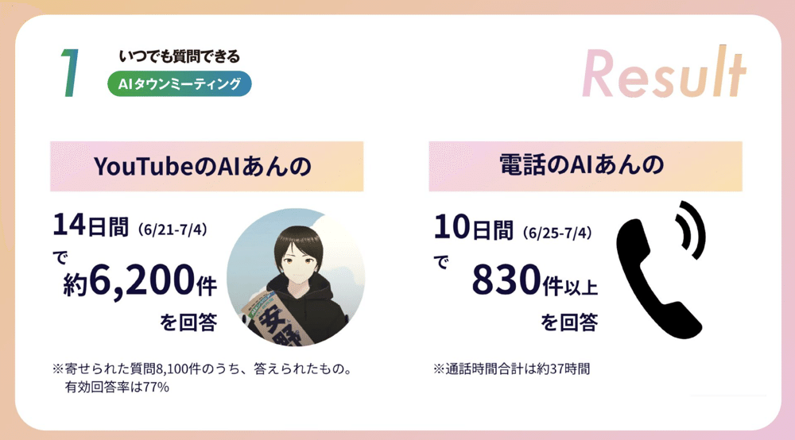
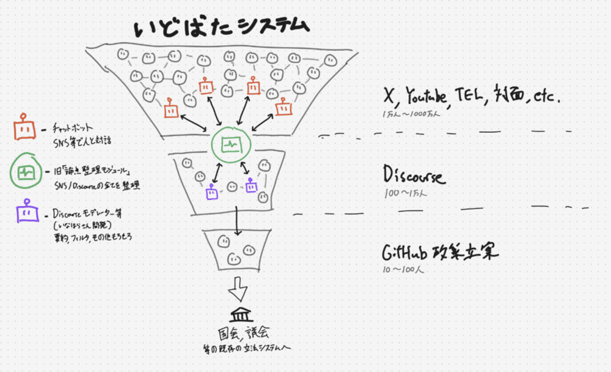
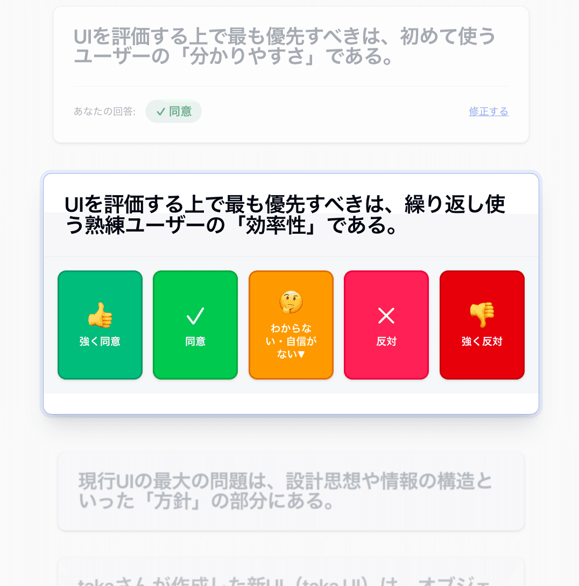
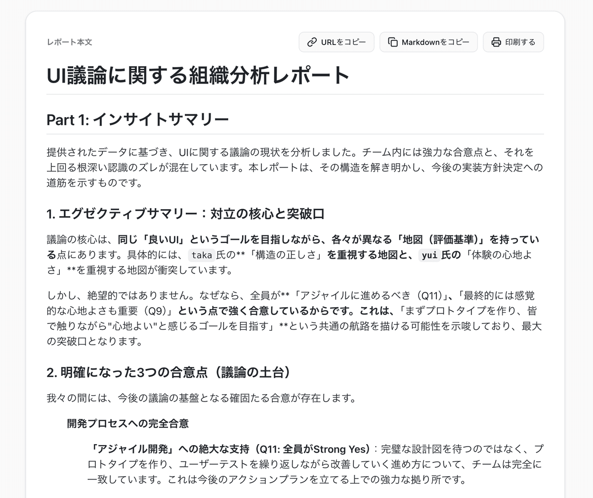

## 1万件の声を集めて気づいたこと

青山柊太朗（[合同会社多元現実](https://www.plural-reality.com/) 創業者 / コロンビア大学 Computer Science & Political Science）

2024年7月、僕は安野貴博さんの都知事選を手伝っていました。エンジニアチームの一員として「AIあんの」の開発に関わり、YouTube Liveのチャットや電話で有権者の質問に24時間応答し続けるAIアバターを作りました。

寄せられた質問は約8,100件、うち有効回答率は77%。一人の候補者が直接聞くことは物理的に不可能な量の声を、AIを介して受け止めました。手応えがありました。

都知事選の後、安野さんが「[チームみらい](https://team-mir.ai/)」を立ち上げ、2025年の参院選に挑むことになりました。僕は[DD2030](https://github.com/digitaldemocracy2030)のコミュニティで「いどばた」という熟議プラットフォームの開発に携わりました。コンセプトは「1億人、日本国民全員で議論できる仕組みを作ろう」というものでした。

さらに市民がチャットで政策への変更提案を出せる「しゃべれるマニフェスト」の仕組みづくりにも関わりました。参院選期間の17日間で9,688件の変更提案が寄せられ、346件が実際にマニフェストに反映されました。妊娠希望者のパートナー向け風しん抗体検査の助成追加、男性へのHPVワクチン公費助成の追加、障害児の「18歳の壁」対策の更新。市民の声が政策文書を書き換えていきます。「声を届ける」仕組みとしては、確実に機能していました。

### 「声を届ける」のその先

でも、ある疑問がずっと残っていました。

9,688件の提案を集めました。1万件近い質問に答えました。それらが政治的意思決定の根幹にある利害調整の材料になったかと問われれば、正直に言えばなっていませんでした。

「こういう声がありました」という分布図はできます。でも「じゃあどうするか」を決めるための材料にはなっていませんでした。集まったものの多くは「断片的な立場表明」にとどまっていたからです。一人ひとりが、自分は何を大事にしていて、何が譲れなくて、何になら妥協できるのかを十分に掘り下げないまま意見を出しています。だから数千件集まっても、それぞれが「なんとなくこう思う」の域を出ません。

「声を届ける」と「意思決定に繋げる」の間に大きなギャップがあります。そして「熟議を1億人にスケールアップさせよう」という発想だけでは、このギャップは埋まりませんでした。

### たった3人の議論が動かなかった日

このことに気づいたきっかけは、意外にも自分たち3人の会社の中にありました。

高木俊輔と西村惟と一緒に「[多元現実](https://www.plural-reality.com/)」を立ち上げた後のことです。プロダクトの管理画面UIについて意見が割れました。一人は設計思想としての正しさを主張し、もう一人は初見ユーザーの体験を重視し、僕はプロトタイプ先行を考えていました。3人とも筋は通っているのに、議論が前に進みません。

観察して気づいたのは、そもそも全員が「自分が何を求めているのか」を言語化できていなかったことでした。同じ「方針」という言葉で、まったく違うレイヤーの話をしていました。「情報量が多い」という指摘にしても、ある人にとっては「不要な情報はない、全部必要だ」で、別の人にとっては「画面に出しすぎ」。対立の原因は意見の不一致ではなく、自己理解の不足でした。

試しに、自分たちが作っている「倍速会議」を自社の議論に使ってみました。AIが出す質問にそれぞれが答えていきます。

すると面白いことが起きました。各自が自分の考えを言語化した段階で、論点の構造が見えたのです。

全員が「アジャイルに進めるべき」「ファーストビューはシンプルにすべき」と思っていました。対立しているようで、土台は一致していました。一方で「わかりやすさと効率性のどちらを優先するか」ではきれいに割れました。この構造が見えた瞬間から、議論が動き始めました。この一点さえ決めれば、あとは合意の上に積んでいけるとわかったからです。

合意形成の問題は、スケールではありませんでした。たった3人ですら、自分が何を望んでいるかを言語化できていなかったのですから。

### 自己理解というボトルネック

コロンビア大学で「[人間と人間の間にAIを挟むことで対話の質がどう変わるか](https://arxiv.org/abs/2502.18201)」を研究してきました。その研究で扱っていたのも、この問題でした。

話すのは人間のままで、AIはその人が自分の考えを深めるための対話相手になります。「なんとなく給食の質が気になる」という漠然とした感覚を、「無償化によるコスト圧縮が品質に影響しているのではないか。事実なら一部有償化してでも質を上げるべきだ」というところまで言語化します。ここまで来て初めて、他者との対話が成立します。

つまり、合意形成のパイプラインの最上流にあるのは「自己理解」です。本人が自分の立場を理解し、言語化できない限り、その先の論点整理も、心理的安全性の向上も、第三の案の探索も、全部滞ります。逆に、一人ひとりが「自分は何を大事にしていて、何が譲れなくて、何になら妥協できるのか」をある程度持てていれば、下流のプロセスは比較的スムーズに回ります。

[ソニーコンピュータサイエンス研究所のCybernetic Humanityチーム](https://cybernetichumanity.com/)で研究しているテーマとも地続きです。コンピューターによって人間の行動が拡張されたとき、どこまで「これは自分の行動だ」という主体感を保てるのか。AIが代わりに意見をまとめてくれるのは便利ですが、それが自分の意見だという実感を失わせてしまっては意味がありません。自己理解の支援と主体感の保持。この二つを両立させる設計が、この領域で一番大事な問いだと思っています。

### スケールアップからスケールアウトへ

だから僕たちの戦略は変わりました。

「スケールアップ」は一度に大人数を巻き込むことです。1億人の意見を集める、数万件の提案を処理する。いどばたやしゃべれるマニフェストが目指した方向はこちらでした。

「スケールアウト」は同じ品質の対話を、多くの現場で同時に発生させることです。名ファシリテーターがいない現場でも、AIの支援によって一定水準の議論ができる状態を作ります。

太田市の自分ごと化会議でその手応えを得ました。会議前にAIとの対話で自分の立場を掘り下げた参加者たちは、開始直後から認識を共有し、「事実か印象か」を問い合えるほどの深い議論に到達しました。20人の住民が、知らない人同士で、初回からそこまでいけました。太田市での取り組みの詳細は、10章「多元現実」で紹介しています。

[多元現実](https://www.plural-reality.com/)を立ち上げたのは、この仮説を現場で検証し続けるためです。DD2030やチームみらいで「声を届ける」仕組みを作ったことは、今の仕事の土台になっています。でも、届けた声を意思決定に繋げるには、一人ひとりの自己理解を支援するプロセスが必要でした。当事者としてブロードリスニングの現場に立ち続けたからこそ、見えてきたボトルネックだと思います。

僕はもともと「対立はなくならない」という前提に立っています。政治哲学者シャンタル・ムフの闘技民主主義に近い考え方です。目指しているのは「正しい答えに辿り着くこと」ではなく、対立のコストを下げることです。違いをそのままぶつけて、そこからより良い答えを引き出す。そのプロセスで、無駄に消耗しない。

一言でいえば「喧嘩がもう少し気楽にできる世界」を作りたいと考えています。そのために一番効く打ち手が、個人の自己理解だというのが、いまの僕の仮説です。
